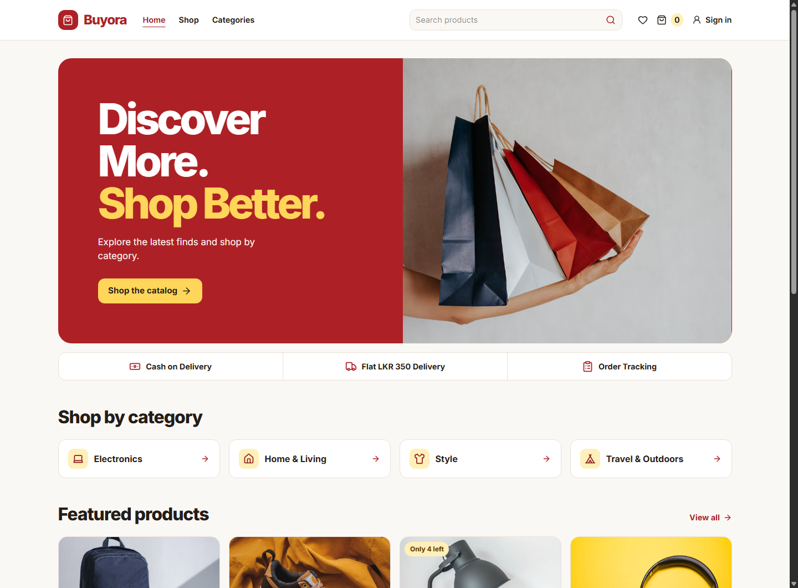
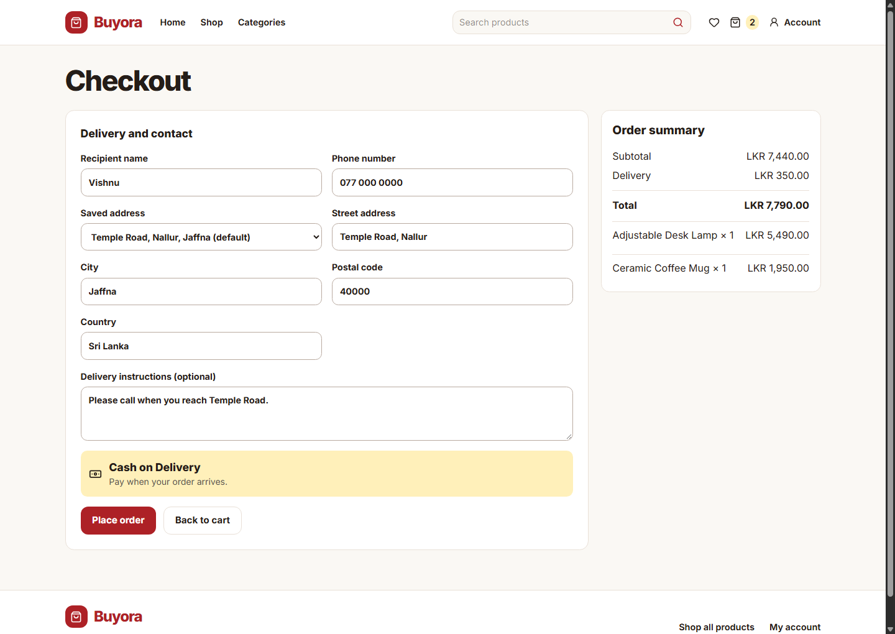
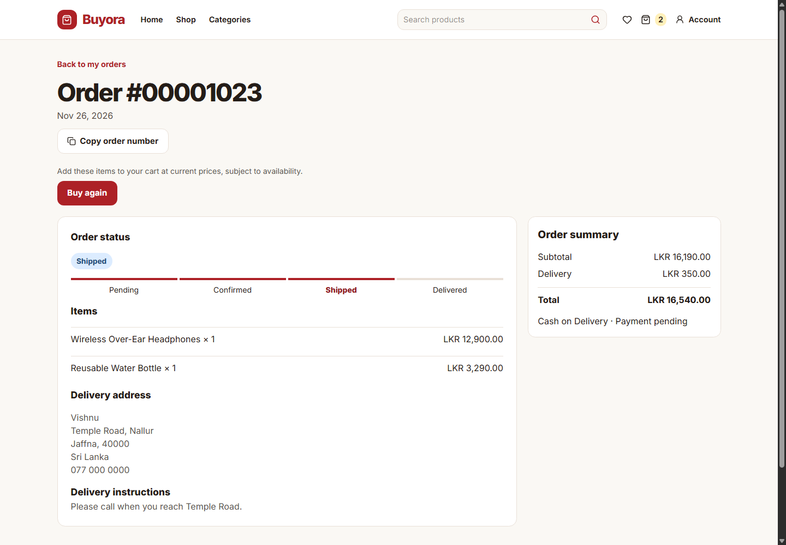
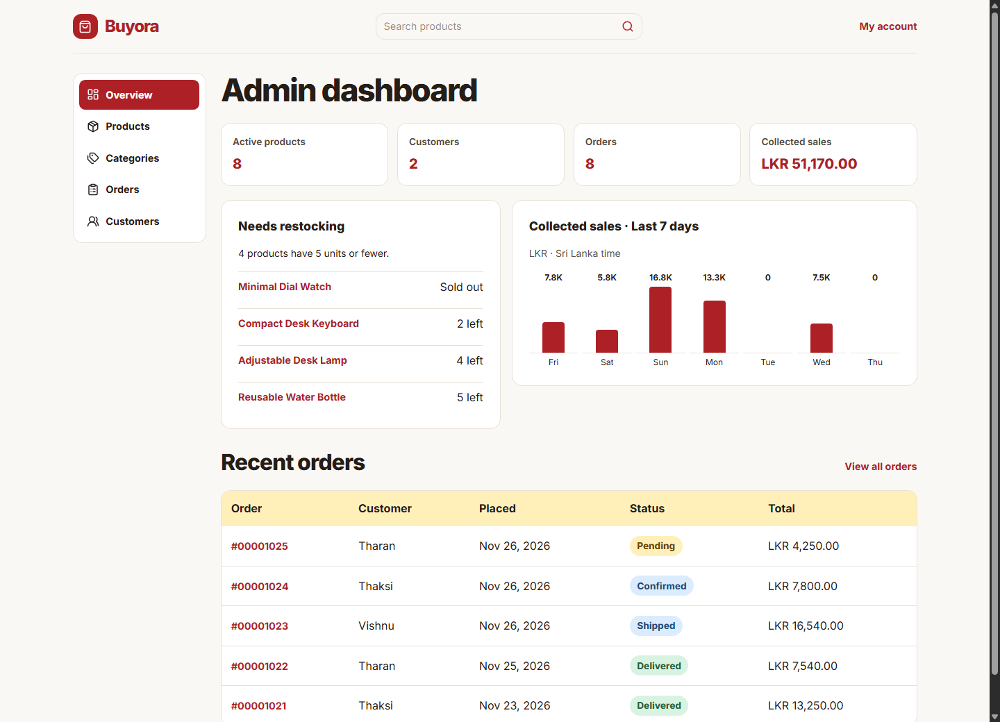

# Buyora

**Discover More. Shop Better.**

[Visit the live store](https://buyoraa.onrender.com)

Buyora is a JavaScript MERN store with a responsive red and yellow storefront. Customers can search and filter products, save a wishlist, manage delivery addresses, and place Cash on Delivery orders in Sri Lankan rupees. Admins can manage the catalog and stock, update orders, search customers, and view collected sales.

## Screenshots

These screens use sample accounts and orders from the Jaffna area.

| Storefront | Checkout |
| --- | --- |
|  |  |
| Browse categories and featured products from the homepage. | Use a saved address and review the Cash on Delivery total before ordering. |

| Order tracking | Admin dashboard |
| --- | --- |
|  |  |
| Follow an order through confirmation, shipping, and delivery. | Review low-stock products, collected sales, and recent orders. |

## Project layout

```text
Buyora/
├── backend/
│   ├── config/              MongoDB connection and indexes
│   ├── controllers/         Catalog, account, cart, order, and admin logic
│   ├── middleware/          Session, role, and error handling
│   ├── models/              MongoDB schemas
│   ├── routes/              Express API routes
│   ├── seeders/catalog.js   Sample categories and products
│   ├── utils/               Session, address, and query helpers
│   ├── .env.example
│   └── server.js
└── frontend/
    ├── index.html
    ├── vite.config.js
    └── src/
        ├── components/      Shared layout, cards, forms, and feedback
        ├── pages/           Storefront, account, checkout, and admin
        ├── api.js           Axios client and request state
        ├── AuthContext.jsx
        └── CartContext.jsx
```

React Router handles navigation. React Context tracks the session and the browser cart. In development, Vite forwards Axios requests from `/api` to Express. Express validates inputs, reads and writes MongoDB through Mongoose, and issues HTTP-only cookies for JWT sessions. Tailwind CSS and Lucide React are used in the storefront.

MongoDB stores product and order amounts as integer cents. The browser displays those values in LKR. Express calculates actual prices, stock, and the LKR 350 delivery fee at checkout. Order creation and stock deduction happen in one transaction. Each account can place up to five new orders in 15 minutes. Retrying a completed checkout with the same key returns its existing order.

## Run locally on Windows

You need Node.js 22.12 or newer, npm, and either a transaction-capable MongoDB Atlas cluster or a local MongoDB replica set. Checkout, password changes, and several admin updates use transactions.

### 1. Install the packages

Run these commands in PowerShell from the project root.

```powershell
npm.cmd ci --prefix backend
npm.cmd ci --prefix frontend
Copy-Item backend/.env.example backend/.env
node -p "require('node:crypto').randomBytes(32).toString('hex')"
```

On an existing setup, keep your `backend/.env` and skip the copy command. Paste the generated secret after `JWT_SECRET=` in that file. Keep the file out of Git.

### 2. Connect MongoDB

For **Atlas**, put your application connection string in `backend/.env` as `MONGODB_URI`, including the database name. Use a database user and allow your development machine's address in the Atlas network access list. [Connect an Atlas application](https://www.mongodb.com/docs/atlas/connect-to-database-deployment/)

For **local MongoDB**, start a development replica set in a separate PowerShell terminal. Adjust the `mongod.exe` path if your installed version differs. Port 27018 and the separate data directory let an existing MongoDB service on port 27017 keep its data.

```powershell
$buyoraReplicaPath = Join-Path $env:LOCALAPPDATA 'Buyora\mongodb'
New-Item -ItemType Directory -Path $buyoraReplicaPath -Force | Out-Null
& 'C:\Program Files\MongoDB\Server\8.0\bin\mongod.exe' --dbpath $buyoraReplicaPath --port 27018 --bind_ip 127.0.0.1 --replSet buyora-rs
```

Keep the MongoDB terminal open. In another PowerShell terminal, go to `backend` and run this initialization command once.

```powershell
cd backend
node --input-type=module -e "import mongoose from 'mongoose'; const client = new mongoose.mongo.MongoClient('mongodb://127.0.0.1:27018/?directConnection=true'); try { await client.db('admin').command({ replSetInitiate: { _id: 'buyora-rs', members: [{ _id: 0, host: 'localhost:27018' }] } }); } finally { await client.close(); }"
```

The local `MONGODB_URI` in `.env.example` already points to this replica set. Update an older `.env` manually if it still points to port 27017. [MongoDB development replica sets](https://www.mongodb.com/docs/manual/tutorial/deploy-replica-set-for-testing/)

### 3. Load the sample catalog and start Buyora

From `backend`, run the optional sample seed and start the API.

```powershell
npm.cmd run seed
npm.cmd run dev
```

The seed adds four categories and eight products to the configured database. Rerunning it preserves product edits and stock, keeps archived products hidden, and leaves accounts alone.

From the project root in another terminal, start the storefront.

```powershell
cd frontend
npm.cmd run dev
```

Open [Buyora](http://127.0.0.1:5173). The API health check is at [port 5000](http://127.0.0.1:5000/api/health). If the database is empty, the storefront shows empty catalog states.

## Shop and place an order

Use **Add to cart** on an in-stock product card to keep browsing without leaving the catalog. Signed-in shoppers can follow a sold-out product with **Notify me when in stock**. Their wishlist shows followed products, and the wishlist icon counts products that are currently back in stock.

Customers can correct the recipient, address, phone number, or delivery instructions on an unpaid pending order. Admin confirmation locks those details.

## Use the admin dashboard

1. Register a separate account through the storefront.
2. Connect MongoDB Compass to the same database as the app. In the `users` collection, find the account by its exact email and set its `role` to `admin`.
3. Sign in with that account and open **My account → Admin area**.

Add categories before products. Enter product prices in rupees and add one image URL per line. Production requires HTTPS image URLs. If an older HTTP image has no HTTPS version, replace its URL before saving the product. A category can be deleted once its active products have been moved or archived. Reload a product before saving if its stock changed during an edit.

In **Admin → Products**, choose **Archive** to hide a product from the store. Open **Archived**, select **Restore**, and confirm with **Restore product**. The original category is selected if it still exists. If it was deleted, choose a replacement category. Restoring keeps the product’s stock, past orders, and stock history.

Search active or archived products by name and combine the search with a category and stock filter. **Low stock** shows 1–5 units. **Needs restocking** also includes sold-out products.

Orders move from **Pending** to **Confirmed**, **Shipped**, and **Delivered**. Cancelling a pending or confirmed order restores stock. Marking an order delivered records its Cash on Delivery payment as paid. Customers can then open the order in **My orders** and choose **Print receipt** to print it or save a PDF.

Admins can record private follow-ups under **Staff notes** on the order page.

Set the checkout delivery window under **Admin → Overview → Delivery estimate**. It uses calendar days after ordering. New orders keep the estimate recorded at checkout.

Use **Admin → Discounts** to create or disable fixed LKR discount codes. Each code has a minimum item subtotal and stays valid through its expiry date in Sri Lanka time. Checkout accepts one code per order and applies it to items before delivery. The order and receipt keep the discount applied at purchase.

If a shipped order is refused or cannot be delivered, mark it **Delivery failed**. Stock stays reserved until the items return. Once all items are received back from a failed delivery or a delivered order, mark it **Returned** and choose whether to restock them. Restock only if every item can be sold again. After money has been refunded to the customer for a paid, returned order, record the amount, refund date, and reason under **Refund records**. Multiple partial refunds can be recorded up to the amount paid.

In **Admin → Orders**, search by order number, customer or recipient name, or phone number. Combine the search with status and date filters. Both dates are inclusive and use Sri Lanka time. Select **Download CSV** to export all orders matching the applied filters. Open an order to print a packing slip with its delivery address, instructions, items, and quantities.

Select pending orders on the current page and choose **Confirm selected** to confirm them together. The result shows which orders need attention. Open an order’s **Order status history** to see who changed its status and when. The history records changes made after this feature was added.

Open a product from the **Active** or **Archived** view to see **Stock history**. It records changes from product creation, manual stock edits, orders, cancellations, and restocked returns.

The admin dashboard opens with shortcuts to **Pending orders** and **Needs restocking**. The restocking preview shows up to five active products, and its shortcut opens the full filtered list. Use **Admin menu** to navigate on smaller screens. The seven-day chart groups collected sales by payment date in Sri Lanka time. Older paid orders without a recorded payment date use their last update date.

Use **Admin → Sales report** to see orders placed, paid orders, collections, refunds, net collections, and best-selling products for an inclusive Sri Lanka date range. Collections count on the payment date, refunds count on the refund date, and products are ranked by units in paid orders.

## Verify the app

| Area | What to check |
| --- | --- |
| Catalog | Search by name, combine category and price filters, sort prices, and open a product. Test a search that returns no results. |
| Reviews | Open a delivered product as its buyer. Save, edit, and remove a review, and verify the product card rating updates. Accounts without a delivered purchase cannot review the product. |
| Account | Register and then sign in. Add, edit, or remove a delivery address. In **My account → Change password**, verify that the current device stays signed in and other sessions end. |
| Cart and wishlist | Add products in two tabs and check both carts update. Sign in with a guest cart. If the merge reaches 50 products or 99 units of one product, check the remaining quantities under **Items waiting to be added**. Sign out and verify that the local cart and recently viewed list are cleared. Save a product to the wishlist, reload its product page, and remove it there. |
| Checkout | Set a default shipping address in **My account** and verify checkout selects it. Add optional delivery instructions, place a Cash on Delivery order, and check the order and its delivery progress in **My orders**. |
| Admin products | Archive a product and verify it disappears from the storefront. Restore it from **Archived** and check that stock and history are preserved. Try restoring a product whose original category was deleted. |
| Admin | Search and filter orders, print a packing slip, and check stock history after a cancellation or restocked return. Verify that marking delivery failed leaves stock reserved. Try the admin URL using a customer account. |
| Build | From the project root, run `npm.cmd run build --prefix frontend`. With the development API running and Vite stopped, use `npm.cmd run preview --prefix frontend`. |

### Postman

Use `http://127.0.0.1:5000` for all requests so Postman can reuse the login cookie. Use JSON for request bodies.

| Request | What to send or check |
| --- | --- |
| `POST /api/auth/register` | `name`, `email`, and `password`. Valid requests get the same empty `204` response for new and existing emails. Sign in separately. |
| `POST /api/auth/login` and `GET /api/auth/me` | Sign in with `email` and `password`, then call the account endpoint. |
| `GET /api/products?q=lamp&maxPrice=6000&sort=price-asc` | Price filters use rupees. The endpoint also supports category, featured status, and pagination. |
| `POST /api/cart/quote` | Send `items` with a `productId` and `quantity` per line. Confirm current stock and total. |
| `PUT /api/wishlist/:productId` and `GET /api/wishlist` | Save a product and verify that it appears once in the signed-in account's list. |
| `POST /api/orders` | Send the cart's `items`, `expectedTotal` from the quote in cents, a UUID `checkoutKey`, and `shippingAddress` with `name`, `phone`, `street`, `city`, `postalCode`, and `country`. `deliveryInstructions` is optional and accepts up to 300 characters. Sending the same request twice returns 201 and then 200 with the same order ID. |
| `GET /api/orders` and `GET /api/orders/:id` | Verify that customers can read their own orders. |
| `GET /api/admin/overview` | Expect 200 for an admin and 403 for a signed-in customer. |

## Common setup errors

| Symptom | Fix |
| --- | --- |
| The API reports a missing secret | Generate a random value with the command above and set `JWT_SECRET` in `backend/.env`. |
| MongoDB cannot connect | Check the connection string, confirm the local replica is running, or review Atlas credentials and network access. |
| Checkout requires a replica set | Point the API at your replica set or Atlas cluster, then restart it. Browsing and cart quotes also work on standalone MongoDB. |
| The origin is rejected | In development, open `http://127.0.0.1:5173`. For another address, set `FRONTEND_ORIGIN` to that exact origin. |
| There are no products | Run `npm.cmd run seed` from `backend` in the database you want to populate, or add products through the admin dashboard. |

## Deploy the built app

Express serves both the built React site and the API in production. This keeps cookies and API requests on the same HTTPS origin. Use a transaction-capable MongoDB Atlas cluster or a managed MongoDB replica set.

From the repository root, use the following build and start commands. Build with frontend development dependencies because Vite and Tailwind are build tools.

```sh
npm ci --prefix backend && npm ci --prefix frontend --include=dev && npm run build --prefix frontend
npm start --prefix backend
```

| Environment variable | Production value |
| --- | --- |
| `NODE_ENV` | `production` |
| `MONGODB_URI` | The database connection string |
| `JWT_SECRET` | A separate random secret of at least 32 characters |
| `FRONTEND_ORIGIN` | The public HTTPS origin, with no trailing slash |
| `PORT` | The host's assigned port when provided |
| `HOST` | Defaults to `0.0.0.0` in production. Use `127.0.0.1` when a reverse proxy on the same machine is the only intended entry point. |
| `TRUST_PROXY` | Leave unset for direct connections. Set a trusted proxy IP or subnet, or a number for a fixed proxy hop count. Use `1` only when all requests reach Buyora through exactly one trusted proxy. Use `loopback` for a proxy on the same machine. |

On **Render**, create a Node Web Service connected to the repository root. Use the build and start commands above, set `SKIP_INSTALL_DEPS=true` because the build command installs both packages, and enter the environment values in the dashboard. Use `/api/health` as the health check. Allow the service's outbound addresses in Atlas. [Render Web Services](https://render.com/docs/web-services) [Render environment variables](https://render.com/docs/environment-variables) [Atlas network access](https://www.mongodb.com/docs/atlas/connect-to-database-deployment/)

On **your own server**, run the built app as a Node service behind an HTTPS reverse proxy. Keep the build and backend in their original directory layout. Set the proxy trust value to match your network. [Express proxy configuration](https://expressjs.com/en/guide/behind-proxies/)

After deployment, test the homepage, a refreshed product URL, sign-in, and `/api/health` at the host's public HTTPS address.

## Credits

The hero photo is by Iuliia Pilipeichenko. Sample product photos are served by Unsplash. [Hero photo](https://unsplash.com/photos/hand-holding-colorful-shopping-bags-against-a-light-wall-6ZgtlGd4RQE) [Unsplash License](https://unsplash.com/license)
